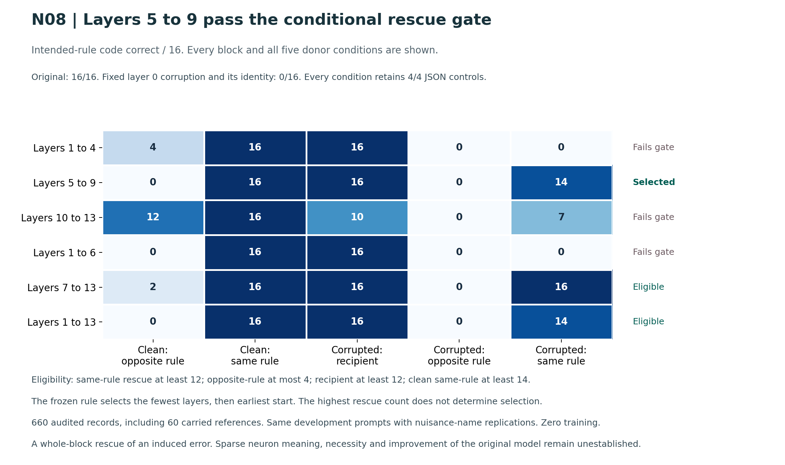

# Gemma Neuron Engineering: Interpretability and Control

We investigate what individual neurons and small groups do in a language model, and whether direct changes to them can improve coding. The current study uses Gemma 4 E2B. All current interventions use zero training: we steer activations, edit connections, remove neurons, clone them and construct prescribed additions.

**Engineering feasibility is established for the tested edits. A semantic neuron role and a coding improvement are not yet established.**

## Documentation

- [Goal & Intent](docs/GOAL_AND_INTENT.html): research questions, technical design, controls and decision rules.
- [Research Logbook](docs/RESEARCH_LOG.html): every recorded experiment, failure, result and subsequent decision.
- [Model identity and precision](docs/model_identity.json).
- [Model bundles and reconstruction instructions](models/README.md).
- [Release inventory and file hashes](PUBLIC_RELEASE_MANIFEST.json).

Clone the repository and open `docs/index.html` to read the HTML documents. GitHub's file viewer shows their source.

## Research method

A gated-MLP neuron has an incoming gate vector, an incoming value vector and an outgoing vector. We observe its activity and test its causal contribution by changing these computations. Necessity, counterfactual rescue, prompt-format controls, matched random interventions, executable coding and retention tests are needed before assigning it a useful function.

There are no optimizer updates, fine-tuning, fitted steering vectors or training of new neurons in the current study. Gradients may measure influence, but are never applied as parameter updates. Development selection and fresh confirmation are kept separate. Earlier training experiments are retained as historical groundwork in the logbook and are closed.

## Results so far

| Study | Evidence | Limit |
| --- | --- | --- |
| N01: localization, steering and additions | 43 conditions and 2,320 binary code-patch decisions. An 8-neuron parallel branch and a 64-neuron residual MLP addition with zero outgoing weights each preserved all 64 baseline logit hashes. | Silent additions establish compatibility. Selected counterfactual groups caused no choice flips on 48 recipient prompts. Activity matching was weak, so specificity is unresolved. |
| N02: physical edits and matched precision | 460 measurements on text-only, unquantized BF16 and same-source NF4 models. Physical deletion matched activity zeroing; doubling an outgoing vector matched gain-2 steering; adding a zero-output neuron preserved its dense baseline. | One channel in layer 34, on 16 reused development prompts. BF16 split cloning changed logits by up to 0.125 within the fixed tolerance. No coding or speed improvement was tested. |
| N03H: token-specific causal paths | Eight small random-weight Gemma configurations and 96 interventions. Predicted past-token zero paths had exactly unchanged later logits and zero measurement gradients. | An implementation fixture, not a pretrained E2B result or a semantic neuron role. |
| N03: native-neuron coding pilot | All 896 BF16/NF4 outputs audited. Every fixed condition scored 4/16 threshold, 4/8 signed division and 8/8 JSON controls. Identity, self-patch, rescue and restoration passed. Real-checkpoint fixed-input late-past path nulls were exact. | No coding gain or semantic role. A two-token contrast missed most dominant errors, and task wording omitted integer types. These limitations and the unchanged grades are retained. |
| N04: copied memory connection | All 288 outputs and controls audited. Historical memory opens the tested late-past causal path; original, off and current-only controls retain the exact null. All fixed policies and reconstruction recipes are retained. | Full replacements fail all 32 outputs. Quarter-strength key-only gains two division completions on four reused name pairs, with unadjusted paired p = 0.5. No confirmed coding benefit or semantic role. |
| N05: native policy transmission | All 336 outputs and identity/self/rescue/restoration controls audited. Original scored 1/16 rounding functions, 4/4 filters and 0/4 strict JSON. Every nonidentity condition lost the same single rounding success. | No specific role or gain. Selected and matched random groups agree. Token caps, function-format violations and fenced JSON limit the assay. Original grades remain unchanged. |
| N06: usability and causal-site gate | All 200 outputs audited. Original filtering was correct on 16/16. Joint early-MLP opposite donors transferred 16/16 to the opposite policy; reversed-mapping same-policy donors preserved 14/16. K/V donors caused no functional flips. All JSON controls passed. | A conditional joint MLP site, not individual neuron meanings or improved coding. Four crossed instruction strata with nuisance-name replications. |
| N07: individual-layer decomposition | All 600 records audited. Layer 0 switches all 16 programs under both opposite-rule and same-rule donors. Layers 4 and 9 each switch two prompts under opposite donors only. All JSON controls pass. | No layer meets the fixed eligibility criterion. The layer 0 effect is label-dependent; an abstract-rule interpretation is unsupported. |
| N08: conditional block rescue | All 660 records audited. Under fixed layer 0 corruption, layers 5 to 9 restore 14/16 programs with same-rule donors, 0/16 with opposite-rule donors and 16/16 with recipient values. All JSON controls pass. | Selected by the frozen smallest-eligible-block rule. Whole-block sufficiency on reused development, without sparse neuron meaning or original-model improvement. |
| N09: influence and matching gate | All 32 activation-gradient measurements passed with frozen weights and four exact ordinary/instrumented logit checks. The highest-ranked coordinate had only 12 eligible controls, below the required 16. | Planned stop with zero new code outputs. No causal neuron effect was tested; the strict controls were preserved. |
| N10: new-site and retention gate | All 168 outputs audited. Changed-wording filter baseline is 16/16, same-rule full rescue 12/16, opposite 0/16 and recipient 16/16. Arithmetic is 4/4 throughout. | JSON baseline is 0/4: objects returned where strings were requested. Planned stop before sparse interventions; original grades remain unchanged. |
| N11: controlled native-neuron necessity and rescue | All 1,152 records audited, including 140 carried originals. The selected 256-neuron group rescues two induced errors and causes four losses when cut from full rescue. Both random groups show zero for both measures. All 48 individual conditions match controls. | The predefined rescue threshold and coverage fail. All 40 main conditions retain 4/4 JSON and 4/4 arithmetic. No original-model coding gain or individual semantic role. |
| N12: rare-neuron baseline check | All 40 originals audited: filtering and predicates 8/8 each; extremum and rounding 0/8 each; retention 8/8. | The planned baseline gate stopped before any neuron or weight edit. Original strict grades remain unchanged. |
| N13: fixed neuron and direct connections | All 640 records audited: 600 new and 40 exact carried originals. Donor swaps, zeroing, doubling and prescribed outgoing-column edits change no correctness outcome. Stored and global activity factors agree exactly on all 80 comparisons. | The activity correlation does not establish a causal rule role. Opposite donors switch 0/16 usable programs. No coding gain or loss. All identity, weight-scope and restoration guards pass. |

N14 is active with ten fixed conditions and 400 planned records, including forty exact carried originals. It compares full native MLP donors at layer 0, layers 5 to 9 and layers 0 to 13. All prompts and grades remain fixed. Its source and auditor were frozen before launch; no result is reported until the full audit passes.

The N02 representations share the pinned floating-point parent. The NF4 intervention first dequantizes the selected MLP and uses its unchanged dense form as the comparison baseline. BF16 is unquantized, but is not FP32. Full transformer-layer insertion remains unvalidated.

Complete aggregates: [N01 conditions](results/n01_development_summary.json), [N01 functional controls](results/n01_function_controls.json), [N02 engineering audit](results/n02_engineering_summary.json), [N03 coding audit](results/n03_coding_summary.json), [N04 host gate](results/n04_host_gate.json), [N04 connection audit](results/n04_connection_summary.json), [N05 complete results](results/n05_anchor_summary.json), [N06 causal-site audit](results/n06_site_summary.json), [N07 full layer audit](results/n07_layer_summary.json), [N08 complete block audit](results/n08_block_summary.json), [N09 planned discovery stop](results/n09_discovery_summary.json), [N10 complete gate audit](results/n10_gate_summary.json), [N11 complete neuron audit](results/n11_neuron_summary.json), [N12 baseline audit](results/n12_baseline_summary.json), [N13 complete fixed-unit audit](results/n13_fixed_unit_summary.json). A [posthoc prefix-activity analysis](results/n12_prefix_contrasts.json) finds that the fixed rare neuron tracks the contextual rule across two wordings; it does not establish a causal role. Startup failures and scientific nulls remain in the [logbook](docs/RESEARCH_LOG.html).



## Code and saved model edits

```text
interpretability/   Observation, activation steering and dense neuron surgery
reproduce/          Pinned-base loaders, reconstruction and verification
models/n01/         Two saved branch tensors and fixed steering policies
models/n02/         BF16 and same-source NF4 physical-edit bundles
models/n04/         Copied-memory recipes and source-module hashes
models/n05/         Fixed native groups and all activation-edit policies
models/n06/         Full-site MLP and shared-read donor policies
models/n07/         All thirty individual-layer policies
models/n08/         All thirty-three conditional block policies
tests/              Small independent fixtures, no pretrained download
docs/               Goal & Intent and sequential Research Logbook
results/            Reviewed experiment aggregates and run history
research/experiments/n03/  Shared-KV causal-path fixture and frozen protocol
research/experiments/n04/  Copied-memory fixture and cache amendment
research/experiments/n05/  Native-anchor intervention fixture
tests/test_selector_site.py  Shared-read donor and cache fixture
```

The saved models are represented by immutable base revisions, compact exact tensors and deterministic edit recipes. This reconstructs the modified models without copying the full base into Git history. Each bundle records source identity, hashes, precision, coordinates and zero optimizer steps. Changed MLP widths require the supplied loader; an unchanged Transformers configuration cannot encode them on its own.

Install and run the local checks:

```bash
python -m pip install -e '.[test]'
python -m unittest discover -s tests -v
python -m reproduce.model_edits --bundle models/n02/bf16_text
```

These commands inspect small fixtures and bundle files. They do not download a pretrained model. To reconstruct or verify an actual model on a compatible GPU, follow the explicit commands in [models/README.md](models/README.md). The public N02 loader also passed an independent T4 package replay: all 24 original output hashes matched, covering six edits in each representation on two existing development prompts. See the [R01 verification](results/r01_reconstruction.json). N01 loader replay is a separate pending check.

## Completed connection experiment

The prototype copies an existing trained key/value projection into a new frozen branch. It asks whether past activity from later native layers can reach future outputs through that new memory route. Fixed historical, current-only and feature-permuted controls separate access to past activity from additional computation and projection compatibility. Original weights receive no updates.

The generic helper is in [memory_connection.py](interpretability/memory_connection.py). To repeat the small random-weight cache and path checks without downloading a checkpoint:

```bash
python -m research.experiments.n04.host_gate
```

The fixture writes local records under `runs/n04/host/version2` and refuses to overwrite a completed result. Its source, cache amendment and aggregate result are public. The real-model gate is complete and its aggregate result is published. All nine model policies are saved in [the N04 recipe](models/n04/recipe.json). The notebook, prompts and raw outputs remain private. A new internal path alone does not show coding improvement.

## Current localization question

N06 passed its baseline-usability gate and produced controlled policy transfers through the joint early-MLP site. Opposite donors switched all sixteen filter programs; reversed-mapping same-policy donors preserved fourteen. Keys and values exposed only to later shared readers caused no functional flips. All retention controls remained correct.

N07 tested every early MLP layer and found no eligible layer. Layer 0 switches the rule even when the donor preserves its meaning under reversed labels. N08 followed that control failure with six fixed later-layer blocks. Layers 5 to 9 passed the predefined conditional-rescue gate. N09 stopped before code testing because strict control matching failed for its highest-ranked coordinate. N10 selected a strictly matchable group but stopped at a JSON baseline-format failure before sparse tests. N11 completed the unchanged selected and random group tests and failed its primary criterion. N12 stopped at a four-domain baseline gate. N13 kept every prompt and grade fixed and tested the originally highest-ranked rare neuron. Its activity tracked the rule, but all sixteen conditions had identical correctness. N14 is a private full-site positive-control study running on those same prefixes. It checks causal coverage before another sparse ranking or neuron construction. All prior failures and grades remain in the logbook. No individual neuron meaning or coding improvement is established. N05's earlier null and format limitations remain unchanged in the logbook.

## Publication scope

This repository contains reviewed goals, methods, code, tests, validated edit bundles and aggregate research records. Private notebooks, datasets, raw predictions, activation traces, historical trained adapters, credentials and the unpublished paper remain outside the repository. The public log records every experiment while the full internal forensic record remains private.

Updates are reviewed before publication. A model edit that changes behavior is not automatically a useful improvement. Existing steering, pruning and function-preserving growth methods are prior work; this project does not claim to have invented them.

## License

Original code and documentation use the Apache License 2.0. Gemma 4 is also released under [Apache 2.0](https://ai.google.dev/gemma/apache_2). Model bundles include source attribution, modification notices and their license. Third-party dependencies retain their own licenses.
